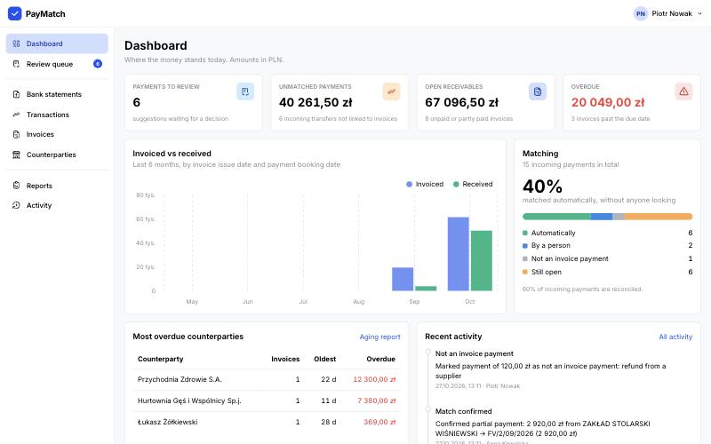
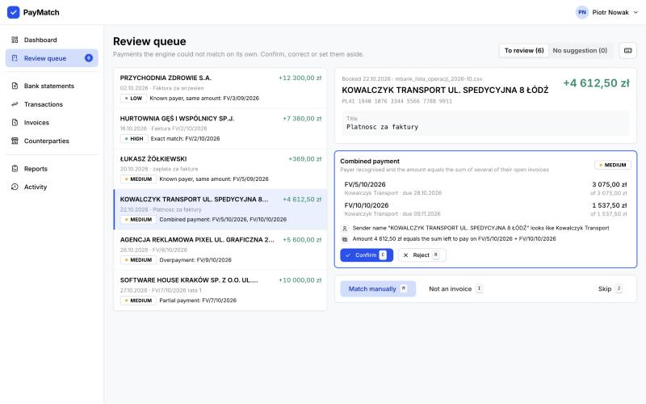
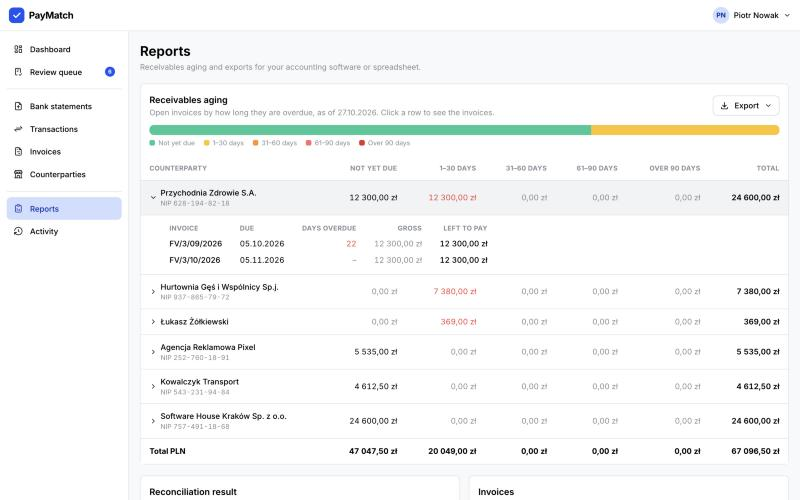
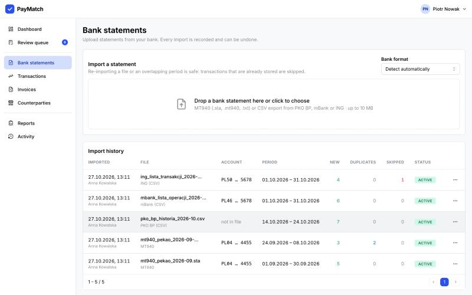
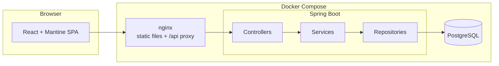
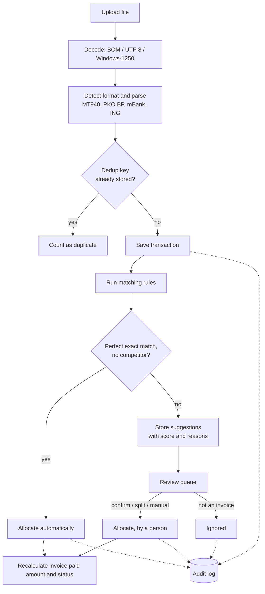

# PayMatch

PayMatch imports bank statements from Polish banks, matches incoming transfers to invoices and gives an accountant
a fast workflow for the payments that can't be matched automatically. It handles the usual mess of real exports
(Windows-1250, `1 230,50`, MT940 sub-fields, overlapping files) and the usual mess of real payers (typos in titles,
partial payments, one transfer for several invoices).

I built it as a portfolio project to show how I approach a small but realistic fintech backend: correctness of money,
idempotent imports, explainable decisions and safe concurrent edits.

## Screenshots

| Dashboard | Review queue |
|---|---|
|  |  |
| **Receivables aging** | **Statement imports** |
|  |  |

## Features

- **Invoices**: create and edit in the UI or import from CSV. Paid amount and status are always derived from confirmed
  payments, never typed in.
- **Bank statements**: MT940 and CSV exports from PKO BP, mBank and ING, with the format detected automatically.
  Every import is recorded and can be undone.
- **Deduplication**: re-importing a file or an overlapping period never creates duplicate transactions.
- **Automatic matching** with explainable rules, a confidence level and the reasons stored for every suggestion.
  Perfect matches are confirmed automatically.
- **Review queue** with keyboard shortcuts: confirm, reject, match manually, split one payment across several
  invoices, mark as "not an invoice payment", undo.
- **Audit log** of every import, match and decision.
- **Dashboard, receivables aging report**, and exports to CSV and XLSX.
- NIP and IBAN validation (checksums) on both sides, consistent JSON errors (RFC 9457), OpenAPI docs.

## Running it

You need Docker. One command starts PostgreSQL, the backend and the frontend:

```bash
docker compose up --build
```

Open http://localhost:3000 and log in as `anna` or `piotr`, password `demo1234`.

On the first start the app loads a demo dataset: 15 invoices and 5 bank statements from the `samples/` folder, imported
through the normal import and matching code, plus a few review decisions made by both demo users. The samples are from
September and October 2026; their dates are moved by whole months so the latest payments always fall in the current
month, and the dashboard is never empty. Invoice numbers keep their original numbering.

To start again from a fresh demo dataset:

```bash
docker compose down -v
```

API documentation (Swagger UI) is at http://localhost:3000/swagger-ui.html. Log in through the app first, the docs
use the same session.

### Development

```bash
docker compose up -d db                     # PostgreSQL on localhost:5433
cd backend && ./mvnw spring-boot:run        # API on http://localhost:8080
cd frontend && npm install && npm run dev   # UI on http://localhost:5173, proxies /api to the backend
```

Requirements: Java 21, Node 22, Docker.

### Tests

```bash
cd backend && ./mvnw test      # needs Docker: integration tests run against PostgreSQL via Testcontainers
cd frontend && npm run lint && npm run build
```

The backend has about 200 tests:

- Parser tests run against the same sample files that are shipped for the demo, plus broken ones (truncated MT940,
  bad amounts and dates, missing columns, unknown format).
- Matching rules have focused unit tests for the edge cases: typos in titles, numbers without prefix, numbers hidden
  inside longer numbers, partial payments, overpayments, double payments, combined payments, ambiguous amounts,
  other currencies.
- Integration tests cover imports and deduplication, the whole matching run on the demo data, review actions,
  exports (the CSV bytes and the XLSX read back with POI), and concurrent decisions.

GitHub Actions runs the backend tests, lints and builds the frontend, and builds both Docker images.

## How it works



The backend is a plain layered Spring Boot application (controller, service, repository), one package per feature:
`invoice`, `statement`, `transaction`, `matching`, `review`, `allocation`, `audit`, `report`, `export`.



1. **Import.** The file is decoded (a BOM means UTF-8, otherwise strict UTF-8 is tried and Windows-1250 is the
   fallback), the format is detected from tags or header names, and the matching parser turns it into bank-neutral
   transactions. Rows that can't be read are skipped with a line number and reason; the file as a whole is rejected only
   if it is unreadable. MT940 balances are checked and a mismatch is shown as a warning.
2. **Deduplication.** Every transaction gets a dedup key (below). Known keys are counted as duplicates, new ones are
   stored. A unique index on the key is the last line of defence.
3. **Matching.** Incoming transactions are run through the rules. A perfect exact match is confirmed on its own;
   anything else becomes a ranked list of suggestions. Matching also re-runs when invoices are added, so a payment
   that arrived before its invoice is still found.
4. **Review.** A person confirms or rejects suggestions, matches manually, splits a payment or marks it as not an
   invoice payment. Every decision can be undone.

## Design decisions and trade-offs

### Money

- `BigDecimal` everywhere in Java, always with scale 2. Parsed amounts with more decimals are rejected
  (`setScale(2, UNNECESSARY)`) instead of rounded, because `10,005` in a bank file means the file is wrong.
- `NUMERIC(19,2)` in PostgreSQL, decimal strings (`"1230.50"`) in JSON. A custom Jackson serializer makes sure no
  client ever receives a JSON number for an amount.
- In the frontend, amounts stay strings. Formatting (`1 230,50 zł`) is done on the string, and sums in the split
  dialog use `BigInt` cents. The only places that turn an amount into a JavaScript number are chart bar heights.
- The XLSX export is the one place where an amount becomes a `double`, because that is how Excel stores numbers.
- An invoice's paid amount is never incremented. After every change it is recalculated as the sum of its confirmed
  allocations, in the same database transaction, so it can't drift from the allocations.

### Deduplication

- **With a bank reference** (MT940 `//reference`, ING "Nr transakcji"): the key is a hash of format + own account
  + reference. Reliable, because banks keep references unique.
- **Without one** (PKO BP and mBank exports): the key is a hash of own account + booking date + amount + counterparty
  account + normalised title (uppercase, no diacritics, letters and digits only), **plus the occurrence number of that
  fingerprint within the file**. Without the occurrence number, two genuinely identical transfers on the same day (two
  equal bank fees, which is in the PKO sample) would collapse into one. With it, they stay two, while the same pair in
  an overlapping export is still recognised.

Limits:

- If a bank changes how it writes titles between two exports, the fingerprint changes and the transaction is imported
  twice.
- If an overlapping file contains only some of a set of identical twins, and in a different order, the occurrence
  numbers can line up wrongly.
- The PKO export doesn't contain the own account number, so two PKO accounts with identical transfers would collide.
- The same account exported once as MT940 (with references) and once as CSV (without) is not recognised as the same
  data.

In practice the fix is to import each account in one format. Every import can be undone if something goes wrong.

### Rule-based matching (and why not ML)

Matching is a handful of small rules behind one interface (`MatchingRule`), each producing candidates with a score and
human-readable reasons:

| Rule | When | Score |
|---|---|---|
| Exact | Invoice number in the title, amount equals what is left to pay | 100; 90 with a typo; 85 without prefix |
| Several invoices | Several numbers in the title, amount equals their sum | 90 |
| Partial payment | Number found, amount is lower | 70 |
| Overpayment | Number found, amount is higher | 65 |
| Already paid | Number of a fully paid invoice (possible double payment) | 40 |
| Known payer, same amount | Payer recognised by IBAN, NIP in title or name, amount equals one open invoice | 75 (60 by name), −25 if several invoices have that amount |
| Combined payment | Amount equals the sum of 2–4 of the payer's open invoices | 70 (60 by name), −15 if ambiguous |

- **Payer cross-check:** if the sender's account belongs to someone else than the invoice's counterparty, the score
  drops by 15.
- **Confidence:** 85+ is high, 55+ medium, below that low.
- **Auto-confirm:** only a perfect exact match (number written as on the invoice, exact amount) with no other
  high-confidence candidate is confirmed automatically. Typos, missing prefixes and combined payments always get a
  human look.
- **Rejected suggestions** are never offered again.

Invoice numbers are compared as tokens, not strings: `FV 4 09 2026`, `fv/10/2026`, `FV10-2026` and `FV/010/2026` all
match, `FV/2/1O/2026` (letter O for zero) matches as a corrected typo. A number never matches inside a longer one:
`FV/1/10/2026` doesn't match `FV/11/10/2026`, and `10/2026` doesn't match `FV/1/10/2026`.

**Why not ML:**

- **Trust:** an accountant needs to know why a payment was matched. "Invoice number found in the title as 'FV 4 09
  2026', amount equals the amount left to pay" is something they can check in a second, and the audit log can store it.
- **Data:** a small company has a few hundred payments a month, not enough data to train anything useful, and a new
  customer has none at all.
- **Accuracy:** the cases that matter (typos, partial and combined payments) are well described by rules.

Learning from manual confirmations is in the "with more time" list below.

### Partial, combined and overpayments

All of them are modelled the same way: a transaction has one or more **allocations** (transaction, invoice, amount),
and the allocations of a transaction must add up to its amount exactly.

- **Partial payment:** one allocation smaller than the invoice; the invoice becomes "partially paid", and the next
  partial payment is suggested against what is left.
- **Combined payment:** several allocations from one transaction.
- **Overpayment:** an allocation larger than what is left; the invoice shows as "overpaid", so the surplus is visible
  rather than silently dropped.
- **Manual split:** the same thing, entered by hand.

### Concurrency

Two people working through the queue at the same time must not corrupt balances:

- **Stale screens:** every review action carries the transaction version the person was looking at. The service
  locks the transaction row (`SELECT … FOR UPDATE`), compares versions and bumps the version on commit. A second
  decision on the same payment waits for the first one and is then refused with 409 ("changed by someone else").
- **One invoice, two payments:** invoices have an optimistic lock (`@Version`), so two different payments
  allocated to the same invoice at the same moment can't both succeed.
- **Deadlocks:** Hibernate updates rows in primary-key order (`order_updates`), so two transactions touching the
  same invoices lock them in the same order.

The first version used only optimistic locking. The concurrency tests then showed a real deadlock: two confirmations of
the same payment deleted each other's pending suggestions. Locking the transaction row first fixed it. The tests use a
barrier so both threads read the data before either writes.

### Undo

- **Undoing an import** removes its transactions and reverts the automatic matches made from them. If a person
  already made a decision about one of its transactions, the undo is refused: silently throwing away someone's work
  is worse than asking them to revert it first.
- **Undoing a match** puts the payment back into the queue with fresh suggestions, but nothing is auto-confirmed
  again. Someone just decided it needs a look.

### Smaller decisions

- **Session login with CSRF protection** (cookie + header) instead of JWT. The SPA and API share an origin, so a
  session cookie is the simplest secure option, and there is nothing to store in `localStorage`.
- **Audit log** entries are written in the same database transaction as the change, so the log never shows something
  that was rolled back. The application never updates or deletes them.
- **"Today"** for due dates and overdue days is the date in Europe/Warsaw, from an injected `Clock`. Timestamps are
  stored as `timestamptz` and shown in Polish time.
- **One company** per installation. Multi-tenancy would add a tenant filter to every query, which wasn't worth it for
  this project.
- **The aging report is always "as of today"**, because paid amounts are stored as current totals.

## Supported bank formats

| Format | Encoding in the sample | Notes |
|---|---|---|
| MT940 | Windows-1250 | `:25:`, `:60F:`/`:62F:`, `:61:`, `:86:` with Polish sub-fields (`~20`–`~26` title, `~27`–`~29`, `~32`–`~33` name, `~30`/`~31`, `~38` account); separators `~`, `^`, `<`; SWIFT envelope stripped; balances checked |
| PKO BP CSV | Windows-1250 | "Key: value" description columns, merchant name taken from card payment location, no own account and no reference in the file |
| mBank CSV | Windows-1250 | metadata block (account, period), `#` column prefixes, account numbers in `'…'`, summary rows ignored |
| ING CSV | UTF-8 with BOM | transaction number used as bank reference, unbooked card authorisations skipped, footer ignored |

The MT940 sample follows the standard layout that Polish banks use. The three CSV samples are **approximations**: I
built them from the publicly known layout of each export (columns, separators, encodings, quirks), not from real
files, and banks change their exports from time to time. See [samples/README.md](samples/README.md).

### Adding a bank

Add one class in `com.paymatch.statement.parser` that implements `StatementParser` and annotate it with `@Component`:

```java
@Component
public class SantanderCsvParser implements StatementParser {

    @Override
    public BankFormat format() {
        return BankFormat.SANTANDER_CSV;          // add the constant with a label to BankFormat
    }

    @Override
    public boolean supports(String content) {
        return content.contains("Data operacji") && content.contains("Santander");  // cheap header check
    }

    @Override
    public ParsedStatement parse(String content) {
        // use CsvStatementSupport to find the header, read rows and look up columns by name;
        // add transactions with statement.addTransaction(...) and bad rows with statement.skip(line, reason, raw)
    }
}
```

Then add a sample file to `samples/statements/` and a parser test next to the others. Detection, deduplication,
matching and the UI pick the new format up without other changes.

## API overview

Full documentation is in Swagger UI. All endpoints except login require a session; errors are RFC 9457 problem details
with an `errors` list for field validation.

| Area | Endpoints |
|---|---|
| Auth | `POST /api/auth/login`, `POST /api/auth/logout`, `GET /api/auth/me`, `GET /api/auth/csrf` |
| Invoices | `GET/POST /api/invoices`, `GET/PUT/DELETE /api/invoices/{id}`, `POST /api/invoices/import`, `GET /api/invoices/{id}/payments` |
| Counterparties | `GET/POST /api/counterparties`, `GET/PUT/DELETE /api/counterparties/{id}` |
| Statement imports | `GET /api/imports/formats`, `POST /api/imports`, `GET /api/imports`, `GET /api/imports/{id}`, `POST /api/imports/{id}/undo` |
| Transactions | `GET /api/transactions` (search, direction, match status, import, dates), `GET /api/transactions/{id}` (with suggestions and allocations) |
| Matching | `POST /api/matching/run`, `GET /api/matching/rules` |
| Review | `GET /api/review/summary`, `POST /api/review/transactions/{id}/confirm \| reject \| allocate \| ignore \| undo` |
| Reports | `GET /api/dashboard`, `GET /api/reports/aging` |
| Exports | `GET /api/exports/reconciliation`, `/invoices`, `/aging` (`?format=CSV\|XLSX`) |
| Audit | `GET /api/audit`, `GET /api/audit/transactions/{id}`, `GET /api/audit/invoices/{id}` |

## Tech stack

**Backend:**

- Java 21, Spring Boot 3.5 (Web, Data JPA, Validation, Security)
- PostgreSQL 17 with Flyway migrations
- Apache Commons CSV, Apache POI
- springdoc-openapi
- JUnit 5 and Testcontainers

**Frontend:**

- React 19, TypeScript, Vite
- Mantine (components, dates, charts) and mantine-datatable
- TanStack Query, React Router

**Infrastructure:** Docker Compose, nginx, GitHub Actions.

## What I'd improve with more time

- **KSeF integration** to import invoices straight from the National e-Invoice System instead of CSV.
- **Bank connection over PSD2 / open banking APIs** instead of uploading files, with webhooks for new transactions.
- **Learning from manual confirmations**: remember the sender account when someone confirms a payment for a
  counterparty without an IBAN, and boost rules that were confirmed often for a given payer.
- **Multi-currency**: EUR invoices paid in PLN, with exchange rates from the NBP API and exchange differences posted
  separately.
- **Historical aging**: store allocation dates explicitly so the aging report can be run for any past date.
- **Split payment (MPP)**: parse the `/VAT/…/IDC/…/INV/…` structure of split-payment transfers into its own fields.
- **Roles**: separate permissions for importing, reviewing and undoing, plus real user management instead of demo
  accounts.
- **Larger volumes**: background import jobs and streaming parsers for files with tens of thousands of rows.
- **End-to-end tests** of the main review flow in the browser (Playwright).
